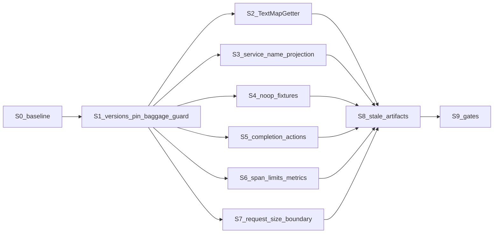

# Миграция на OpenTelemetry SDK 1.67.0 и instrumentation 2.33.1

## Основание

Источники проверены по исходникам в `E:\Platform_Traces_Archive\src`:

- `opentelemetry-java-1.66.0`, коммит `300a358`;
- `opentelemetry-sdk_1.67.0`, тег `v1.67.0`, коммит `b4b3a1b`;
- `opentelemetry-java-instrumentation-2.32.0`;
- `opentelemetry-java-instrumentation-2.33.0`, тег `v2.33.0`, коммит `46bb2143`. Этот pin фиксирует `otelSdkVersion = "1.67.0"`. Целевой pin — `v2.33.1` (`d9045e02`): отличается от 2.33.0 только schema URL четырёх resource-детекторов (#20915), см. S1.

Первичный анализ:

- [SDK 1.66 to 1.67 API diff](d3440546-a28e-4b18-a0a3-b86608fcb2d7);
- [Instrumentation 2.32 to 2.33 diff](22fe0e25-eaf3-4f61-be3a-698edc711996);
- [OTel usage and overengineering inventory](7a18ce72-631f-42a6-b6b9-a22ff94d9afd).

Проверка внешних ревью (Grok 4.7 Extra High Fast, ключевые утверждения перепроверены по коду):

- первый раунд: [S7 export budget](635c565b-795c-44d5-b9d6-bd29e22cae78), [S3 resource identity](052f278b-fef7-40d8-ba47-6dcc9df5c962), [S5/S4 lifecycle](364f1fcd-f1a3-4b7b-89cb-55c07cadf1b2), [S1/S2/S8 boundaries](75fb3b8f-0240-4e77-a6be-d0c238e8000e);
- второй раунд (Perplexity Model Council): [S7 retry and limits](347fc0a7-215b-4dcb-bb5b-c39eef205096), [S3 disabled keys and order](c5801d9e-6ead-4a90-8be7-1f1c779cf8d6), [S2/S5/S6](bfbe42a4-e530-47da-a69b-5e46f92c8a78), [S1/S8/S9](098a6044-d62f-40ff-a6bf-ba0f9fb04630).
- третий раунд (Perplexity Model Council, round 2): [Agent 2.33.1 schema](bf898e55-fd40-4700-bbe4-3f70479e5497), [Collector batching limits](9645ae43-1f99-4ea2-b514-6c82a9a05d1b), [Exporter replacement lifecycle](90f66aba-4567-48c0-a011-211197b533a9), [S5/S6/S9](10b161a1-42f1-4354-a105-2fff6adb9483).
- четвёртый раунд (Perplexity Model Council, round 3): [Collector splitter](149734b2-8e15-497b-a4e7-3ab5cc524be5), [Exporter copy completeness](840b45ef-4bca-48e0-9dfc-02edfc859938), [S1/S3 detectors](3069161f-2d0c-4db0-8c7e-5b476076358b), [S5/S9/Jaeger](77a4b36d-5744-41da-a462-2fa654212a2a).

Факты, ограничивающие объём:

- Байт-идентичны 1.66.0: `BatchSpanProcessor`, `SpanData`, `DelegatingSpanData`, `ExtendedSpanProcessor`, `ReadWriteSpan`, `Sampler`, `AutoConfigurationCustomizer(Provider)`, `ComponentLoader`, `SdkTracerProviderBuilder`, sender SPI (`GrpcSender*`, `HttpSender*`, `MessageWriter`), `OkHttp*SenderProvider`, `RetryUtil`, `RetryPolicy`, `OkHttpHttpSender`.
- Изменены реализации: `OkHttpGrpcSender` (+119/−39) и `RetryInterceptor` (PR #8854). gRPC-статус читается и из trailers; retry ограничен export timeout через новый `RetryState`.
- В 2.33.0 байт-идентичны `javaagent-extension-api`, `javaagent-tooling`, `javaagent-bootstrap`, `sdk-autoconfigure-support` и main-исходники `instrumentation-api`.
- Новых hook для request/correlation id, span-end, sampler или MDC в 2.33.0 нет.
- Инвентаризация не нашла типов с вердиктом REMOVE. Чистка ограничена мёртвыми ветками и устаревшими артефактами.

Изменённые контракты 1.67, у которых в репозитории есть потребитель:

- `TextMapGetter` стал `@FunctionalInterface`, `keys()` — `@Deprecated` default с пустым списком. Вызывают его только `JaegerPropagator:260` и `OtTracePropagator:145`; оба платформа отклоняет при подготовке агента.
- Ресурс получил entities. Entity `service` создаётся только из `otel.service.name` (или `otel.entities`). `ServiceInstanceIdResourceProvider` стал stable, создаёт entity `service.instance`, `order()==Integer.MIN_VALUE`. `otel.resource.disabled.keys` применяется до resource customizer. Литеральные non-ASCII в `otel.resource.attributes` больше не портятся.
- `SdkTracerProvider.tracerBuilder` без процессоров возвращает `TracerProvider.noop()` (`SdkTracerProvider.java:104-106`).
- `CompletableResultCode.runActions` ловит `RuntimeException` (не `Exception`, не `Error`), пишет JUL WARNING, выполняет остальные действия и бросает первое повторно (`CompletableResultCode.java:157-172`). `whenComplete` на завершённом результате синхронен.
- `AttributesMap.put`: перезапись существующего ключа не увеличивает `totalAddedValues`.
- OTLP gRPC/HTTP отклоняют сериализованный запрос больше 64 MiB до sender (`ofExceptionalFailure`, 0 вызовов sender). Публичные `OtlpGrpcSpanExporterBuilder.setMaxRequestMessageSize` и `OtlpHttpSpanExporterBuilder.setMaxRequestBodySize`; 0 отклоняется. Ключа env/system property нет.
- gRPC retry включён по умолчанию. Разбор числа попыток за 10 с — в S7; это арифметика `RetryState`, не прогон коллектора.
- Pin `opentelemetry-proto` у SDK 1.67 — `1.11.1-alpha`.



## S0. Базовый прогон

Действующая базовая линия — **PASS**. Каталог: `bom-opentelemetry = 1.66.0`, `bom-otelproto = 1.11.0-alpha`, `bom-otelinstrumentation = 2.32.0`, `bom-otelextension = 2.32.0-alpha`. Сумма двух прогонов 2026-10-29: 4051 тест, 0 падений, 0 errors, 0 skipped.

| Модуль | Тесты | Падения |
|---|---:|---:|
| spring-boot-starter-platform-tracing-api | 82 | 0 |
| platform-tracing-runtime-policy | 183 | 0 |
| spring-boot-starter-platform-tracing-otel | 326 | 0 |
| spring-boot-starter-platform-tracing-autoconfigure | 926 | 0 |
| spring-boot-starter-platform-tracing-autoconfigure-webmvc | 68 | 0 |
| spring-boot-starter-platform-tracing-autoconfigure-webflux | 75 | 0 |
| platform-tracing-testkit | 108 | 0 |
| platform-tracing-otel-javaagent-extension | 1980 | 0 |
| platform-tracing-jib-plugin | 166 | 0 |
| platform-tracing-jmx-contract | 50 | 0 |
| platform-tracing-e2e-tests | 11 | 0 |
| platform-tracing-build-logic | 76 | 0 |

Прогон модулей starters: `gradlew --continue --no-daemon --no-build-cache` с `cleanTest` перед каждым `test`, 3975 тестов. Лог: `%TEMP%\otel-migration-full-test-nocache.log`.

Прогон included build: `gradlew -p platform-starters-tracing/build-logic cleanTest test --no-daemon --no-build-cache --continue`, 76 тестов, 9 классов. Счётчики из `build/test-results/test/TEST-*.xml`. Лог: `%TEMP%\otel-migration-build-logic-baseline.log`.

Два дефекта закрыты до миграции:

- `BoundTracingSettingsSources.StartupConfigProperties.getList` возвращал `null` вопреки контракту `ConfigProperties.getList`. Фикстура возвращает `List.of()`.
- `PropagatorConfigurationContractTest` ожидал текст сообщения до фразы `these propagators carry baggage outside the platform policy`. Ожидание приведено к текущему сообщению.

## S1. Версии, pin агента, защита baggage-политики

- [gradle/libs.versions.toml](gradle/libs.versions.toml) `:48-52`: `bom-opentelemetry = "1.67.0"`, `bom-otelproto = "1.11.1-alpha"`, `bom-otelinstrumentation = "2.33.1"`, `bom-otelextension = "2.33.1-alpha"`. `bom-protobuf` выровнен на `4.36.2`: это версия, которую требует `opentelemetry-proto:1.11.1-alpha`; каталожный `4.35.1` проигрывал conflict resolution, и `validateJavaAgentExtensionComponents` отвергал расхождение packaged/runtime.
- Выполнено. SHA JAR `opentelemetry-javaagent-2.33.1` — `e43a270df53c6f423e0ab157be9c27ccc01d5dc3232e162fe54777573db2f149`. Семь provider из `inst/META-INF/services/...AutoConfigurationCustomizerProvider` совпали с прежним pin, порядок по имени класса не менялся. Запрет include — `BaggageAttributeCopyContract`. Остаточный schema-риск AWS записан в `ADR-resource-merge-precedence.md`.
- Почему 2.33.1, а не 2.33.0. Тег `v2.33.1` (`d9045e02`, 2026-10-26) целится в SDK 1.67.0, `otelContribVersion` остаётся `1.61.0-alpha`; единственный функциональный фикс — #20915 (10 файлов в `instrumentation/resources/library`, остальное в diff `v2.33.0...v2.33.1` — release metadata). В 2.33.0 `HostResource.java:46`, `OsResource.java:65`, `ProcessResource.java:120`, `ProcessRuntimeResource.java:51` объявляют `SchemaUrls.V1_24_0`; SDK 1.67 при заданном `otel.service.name` строит entity `service` со schema 1.40.0 (`EnvironmentResource.java:62-69`). `Resource.merge` при разных непустых schema пишет INFO (`Resource.java:238`) и обнуляет `schemaUrl`. На 2.32/1.66 конфликта нет: там `otel.service.name` даёт `Resource.create` без schema. S3 включает `otel.service.name` на каждом сервисе, поэтому на 2.33.0 каждый сервис терял бы resource-level `schema_url`. Экспорт при этом не ломается, теряется только метаданное для schema transformation в коллекторе.
- Остаточный риск, не закрываемый 2.33.1: AWS-детекторы contrib 1.61.0 (`Ec2Resource.java:134`, `EksResource.java:89`, `EcsResource.java:85`, `LambdaResource.java:63`, Beanstalk) объявляют schema 1.25.0. В AWS их ненулевой ресурс при merge с 1.40.0 даёт INFO и `schemaUrl == null`. Azure и GCP создают ресурс без schema, конфликта нет (`Resource.java:233-246` логирует только при двух разных ненулевых schema). Cloud Foundry при наличии `VCAP_APPLICATION` объявляет 1.24.0. Вне облака все ветки возвращают пустой ресурс или пустые атрибуты без schema (по исходникам; исполнением не проверено). Ограничение фиксируется в ADR, кода не требует.
- Off-cloud стоимость старта: EC2 опрашивает IMDS с timeout 2 с (`SimpleHttpClient.java:36`), Azure VM — 5 с (`AzureMetadataService.java:26`), у GCP `fetchAttribute` timeout не задан (`GcpMetadataConfig.java:146-170`). Миграция это поведение не вводит (contrib-детекторы входят в агент и до 2.33), но разница с 2.32 по исходникам не сверялась; фактическая длительность — `INSUFFICIENT_EVIDENCE`.
- Дистрибутив получает версию агента из каталога (`platform-tracing-otel-javaagent-distribution/build.gradle:45`).
- Пересчитать `otel.javaagent.sha256` в [otel-javaagent-acp-pin.properties](platform-starters-tracing/platform-tracing-otel-javaagent-extension/src/main/resources/META-INF/platform-tracing/otel-javaagent-acp-pin.properties) по скачанному JAR 2.33.1. `agent.sha256` и GAV упакованного агента пишет сборка (`WriteJavaAgentPinTask`, `javaagent-distribution.properties`).
- `provider.0..6` перепроверить по JAR 2.33.1. Класс `BaggageProcessorCustomizer` в дереве instrumentation нет: агент 2.33 берёт его из `opentelemetry-baggage-processor` `1.61.0-alpha` (`dependencyManagement/build.gradle.kts:10,107`, `javaagent-tooling/build.gradle.kts:53`, `javaagent/build.gradle.kts:76`). Исходник тега `v1.61.0` (`9cf14dc`, `version.gradle.kts` `alphaVersion = 1.61.0-alpha`) совпадает с `v1.60.0` (`e98d757`, зависимость агента 2.32): два ключа `otel.java.experimental.{span,log}-attributes.copy-from-baggage.include` и `return` при пустом списке (`BaggageProcessorCustomizer.java:36-39,49-52`). Пакет `io.opentelemetry.contrib.baggage` shadow агента не переносит. Опубликованный JAR 2.33.0 в кэше Gradle отсутствует; отдельная сверка его байт-кода не нужна.
- Fail-closed запрет обоих ключей. `BaggageProcessorCustomizer` при непустом include ставит `BaggageSpanProcessor`/`BaggageLogRecordProcessor` первыми и копирует baggage в атрибуты в обход `platform.tracing.baggage.span-attributes.*`. Проверка добавляется в существующий configuration contract рядом с `PropagatorConfigurationContract.requireSupported` (`AutoconfigureSessionFactory.java:50-51`), ошибка — `ConfigurationPropertyException` с именем ключа. Провайдер из pin не удаляется: агент публикует его через SPI, `TracePipelineSpiVerifier` упадёт.
- Fixtures текущего pin: `ControlledAgentDistributionContractTest.java:488`, `ControlledAgentTestArgumentsTest.java:98`, строки `"2.32.0"` в `BootstrapTerminalTransitionsTest:981`, `AutoconfigureSessionFactoryCleanupTest:98`, `AutoconfigureSessionFactorySamplerTest:145`, `SamplingRatioFacadeVsSamplerParityTest:100`.
- Тесты: параметризованный отказ на каждый из двух ключей с непустым значением; пустое значение отказа не даёт.
- Exit: `compileJava`/`compileTestJava` всех модулей; тесты `build-logic`; `ControlledAgentVerifier` принимает новый SHA.

## S2. `TextMapGetter`: функциональный контракт

- Удалить override `keys()`:
  - production: [OtelTraceparentReaderImpl.java](platform-starters-tracing/spring-boot-starter-platform-tracing-otel/src/main/java/space/br1440/platform/tracing/otel/propagation/OtelTraceparentReaderImpl.java) `:116-122` — `enum CarrierGetter` остаётся, удаляется только `keys`;
  - тесты extension, 10 мест: `TraceControlPropagatorTest:32,129`, `TraceControlPropagatorProviderTest:27`, `SafeTextMapPropagatorTest:119`, `PlatformBaggagePropagatorTest:40`, `PlatformBaggagePropagatorInjectionTest:108`, `PlatformBaggagePropagatorBaggageLimitsTest:29`, `BaggagePropagationCustomizerTest:208`, `BaggageIngressPipelineTest:34`, `PlatformPropagationAutoconfigureIntegrationTest:181` — анонимные классы заменить лямбдами.
- Отказ `jaeger`/`ottrace` уже закреплён тестами `PropagatorConfigurationContractTest:24-42` и `PlatformPropagationAutoconfigureIntegrationTest:271-306`; новый тест не нужен.
- Gate: ArchUnit-правило на main рядом с `RuntimeFacadeBoundaryArchTest` модуля otel — класс, реализующий `TextMapGetter`, не объявляет `keys`. Правило «никто не вызывает `keys`» не вводится: вызовов нет, и оно не ловит `CarrierGetter`. Негативная фикстура и проверка, что правило применилось к `CarrierGetter`.
- `-Xlint:deprecation`/`-Werror` не вводятся.

## S3. Источник `service.name`: проекция в properties-слой

- В существующем properties customizer `BootstrapAutoConfigurationCustomizerProvider` (`order()==100`) проецировать `platform.tracing.service.name` в `otel.service.name` при одновременном выполнении:
  - `config.getString("otel.service.name") == null` — именно `null`; пустая строка и пробелы считаются заданным значением;
  - `!config.getMap("otel.resource.attributes").containsKey("service.name")`;
  - `StringUtils.hasText(platform)`; в override кладётся `strip()`.
- Иначе customizer возвращает пустую map. Проекция blank-значения запрещена: она подавит Spring/Manifest/Jar detector, который сегодня побеждает при пустом platform-имени.
- `SERVICE_NAME` удалить из additions в [PlatformResourceCustomizer.java](platform-starters-tracing/platform-tracing-otel-javaagent-extension/src/main/java/space/br1440/platform/tracing/otel/javaagent/resource/PlatformResourceCustomizer.java) (`:75-99`). Required-проверка `service.name` (`isRealServiceName`, ERROR/WARNING) остаётся отдельной и выполняется по итоговому ресурсу. Остальные четыре атрибута, `otel.resource.disabled.keys` и fail-open в WARNING-режиме не меняются.
- Строка-победитель `service.name` не меняется ни в одном сценарии; меняется форма: platform-имя становится entity `service` (schema 1.40.0), как явный `otel.service.name`. Корректный resource-level `schema_url` при этом обеспечивает только агент 2.33.1 (S1); на 2.33.0 merge с детекторами 1.24.0 даёт `null` и INFO.
- Тесты:
  - unit предиката: non-null `otel.service.name` (`""`, пробелы) не перезаписывается; `service.name` в `otel.resource.attributes` блокирует; `service.name=` в map не блокирует; blank platform не даёт ключа; `" demo "` даёт `demo`;
  - `ResourceCustomizerAutoconfigureIntegrationTest` на реальном `AutoConfiguredOpenTelemetrySdk`: проекция даёт `service.name` и entity `service`; явные `otel.service.name` и `service.name` в attributes побеждают; JUL `io.opentelemetry.sdk.resources` без WARNING;
  - там же `otel.resource.disabled.keys=service.name`: атрибута нет, customizer его не возвращает, WARNING-режим логирует `RESOURCE_IDENTITY_INCOMPLETE`, ERROR-режим падает;
  - `service.instance.id=x` в `otel.resource.attributes` остаётся `x`;
  - `errorFailsWhenRequiredKeysAbsent` сохраняется;
  - schema-тест на реальном autoconfigure с `opentelemetry-resources` 2.33.1 (сейчас JAR в тестах нет: `build.gradle:79-86`, поэтому существующий тест конфликт не собирает). Требования ([S1/S3 detectors](3069161f-2d0c-4db0-8c7e-5b476076358b)):
    - JAR не кладётся в `testImplementation`. Он регистрирует ещё `Container`/`HostId`/`Manifest` (`@AutoService(ResourceProvider)`), а `AutoConfigurationCustomizerTestClassLoader` скрывает только `AutoConfigurationCustomizerProvider`. Поэтому JAR изменил бы ресурсы всех семи SDK-тестов модуля (25 методов). JAR берётся из отдельной Gradle-конфигурации, путь передаётся тесту system property, и только этот тест собирает SDK на `URLClassLoader` через `setServiceClassLoader`;
    - `otel.java.enabled.resource.providers` = FQCN четырёх instrumentation-провайдеров (`Host`, `Os`, `Process`, `ProcessRuntime`) и двух SDK-провайдеров (`EnvironmentResourceProvider`, `ServiceInstanceIdResourceProvider`); SDK-провайдеры нужны для источника service.name и entity. Ключей `otel.resource.providers.*.enabled` в SDK нет (`ResourceConfiguration.java:30-32`);
    - доказательство загрузки детекторов: присутствуют `host.arch`, `os.description`, `process.executable.path`, `process.runtime.name`. `host.name` и `process.pid` условны (`HostResource.java:33-36`, `ProcessPid.java:14-27`) и единственным доказательством не используются. Без этих атрибутов тест даёт ложный PASS: schema 1.40.0 и отсутствие INFO обеспечивает сам SDK, потому что `ServiceInstanceIdResourceProvider` всегда строит entity со schema 1.40.0 (`ServiceInstanceIdResourceProvider.java:35`);
    - `resource.getSchemaUrl()` равен `https://opentelemetry.io/schemas/1.40.0`; JUL-логгер `io.opentelemetry.sdk.resources.Resource` на уровне INFO не содержит `Attempting to merge Resources with different schemaUrls`. Проверка WARNING этот дефект не ловит — уровень INFO;
    - на 2.33.0 тот же тест обязан падать; это проверяется однократно при реализации и фиксируется в отчёте.
  - E2E упакованного агента: stderr не содержит `Attempting to merge Resources with different schemaUrls`. Это валидно при дефолтном `otel.javaagent.logging=simple`: slf4j-simple пишет INFO в `System.err`, а JUL агента переписан на `PatchLogger` (`AgentStarterImpl.java:77-80`, `javaagent-shadowing.gradle.kts:30`). Проверка доказывает отсутствие конфликта четырёх детекторов, но не cloud-schema.
- Не пишутся: тест «entity `service.instance` переживает host/container/version» (ключи не входят в identity entity, тест тривиален), отдельные тесты Spring/Manifest/Jar detector, тест `otel.experimental.resource.disabled.keys` (SDK 1.67 его не читает).

## S4. Пустая цепочка процессоров и noop-tracer

С установленным extension SDK без процессоров не строится: `buildDelegates` всегда добавляет три процессора (`PlatformSpanProcessorFactory.java:62-64`), `otel.sdk.disabled=true` отвергается до построения SDK, `exporter=none` не снимает composite.

- Удалить недостижимую ветку `if (delegates.isEmpty()) return;` (`PlatformSpanProcessorFactory.java:137-143`).
- В Javadoc `buildDelegates` записать: три делегата обязательны; без них `SdkTracerProvider` 1.67 возвращает noop tracer, и MDC/requestId перестают работать.
- Фикстуры noop-tracer уже переведены при S1, потому что bump ломает их до отдельного среза: `ScrubbingRuntimeCurrentBehaviorTest` (три метода), `RequestTraceContextSnapshotSupplierTest` (autoconfigure), `NoOpTracingRuntimeTraceparentContractTest` (план его не называл; `isValid()` падает на noop). Провайдер с `SimpleSpanProcessor` и `SpanExporter.noop()`. Остаток S4: удаление пустой ветки и Javadoc `buildDelegates`.
- Тесты на `exporter=none` и runtime-диагностику пустой цепочки не добавляются.

## S5. Completion actions на 1.67

`FlushTracker.completeAfterUnlock` сохраняется: он отпускает `ReentrantLock` буфера до `succeed`/`fail` и изолирует `Throwable` по каждому `FlushCompletion` с `propagateIfFatal` (`FlushTracker.java:70-106`); upstream ловит только `RuntimeException`. Доказательства — `ExportBufferTest.java:144-198`.

- `ExportWorker.java:98-101`: callback `whenComplete` — `releaseDelegate()` первым, затем `reportDelegateReleased` внутри `try/catch (Throwable)` с `PlatformThrowables.propagateIfFatal`; нефатальное не пробрасывается. `try/finally` недостаточен: на завершённом результате `runActions` синхронно пробрасывает `RuntimeException` в `exportBatch`, `ExportWorker.run` (`:51-56`) останавливает цикл с `EXPORT_WORKER_TERMINATED_ABNORMALLY`.
- `CompositeLifecycleCoordinator` не меняется. Между отказом и `observedResult.fail()` стоит только `recordError` (`:134-146`): `AtomicLong.incrementAndGet()` на экземпляре, который всегда создаёт `DelegateWiring.java:50`, и `log.log(...)`, чья лямбда выполняется внутри `catch (Throwable)` + `propagateIfFatal` (`AgentLoggingRuntime.java:126-154`). Событие `COMPOSITE_PROCESSOR_LIFECYCLE_FAILED` — `WARN` + `optionalCause` (`ExportPipelineLogEvent.java:61-66`). В `completeShutdown` между `!isSuccess()` и `fail()` операторов нет (`:91-94`, `completeFrom` `:149-156`). Нефатальной точки выброса нет, тест без нового seam её не вызовет; `finally` закрывал бы недостижимый путь. Невыброс логгера уже доказан `AgentLoggingFailurePathTest.java:27-113` и `AgentLoggingRuntimeTest.java:90-105`.
- В `src/main` extension восемь `CompletableResultCode.whenComplete`: `ExportWorker.java:98`, `SafeSpanExporter.java:137,386,402`, `CompositeLifecycleCoordinator.java:39,65,116,150`. Меняется только `ExportWorker.java:98`, остальные семь не меняются.
- Тест детерминированный (latch, ограниченный `await`): уже завершённый delegate, reporter бросает `RuntimeException` — слот освобождён, worker экспортирует следующий батч.
- `@RepeatedTest` и платформенный дубль upstream-теста lock inversion не пишутся.

## S6. `SpanLimitsMetricsProcessor`

- Процессор сохраняется отдельно: собственная метрика и потребитель.
- Порядок: in-place scrubbing — `onEnding`, метрика — `onEnd` (`SdkSpan.java:571-582`, `PlatformSpanProcessorFactory.java:67-68`). На 1.67 перезапись ключа scrubbing-ом drop не увеличивает. Тестов со старой семантикой нет.
- Тесты: повторный `setAttribute` того же ключа не увеличивает счётчик; превышение `otel.span.attribute.count.limit` увеличивает; in-place scrubbing не увеличивает счётчик.
- Boundary scrubbing (`SpanDataBoundaryScrubber:105,135`) переносит исходный `getTotalAttributeCount()` в `ScrubbedSpanData`; OTLP `dropped_attributes_count` = исходный total минус оставшиеся атрибуты, то есть включает удалённые scrubbing-ом. Решение уже принято: `ADR-scrubbing-hybrid-processor-export-boundary.md:72` требует сохранять recorded count. Proto `v1.11.1` (`trace.proto`) не ограничивает поле limit-based отбрасыванием: у Span причины перечислены через «can be», у Event/Link причин нет. Пересчёт `adjustedTotal` не вводится, ADR не меняется.
- Passthrough уже закреплён для event/link (`SpanDataBoundaryScrubberTest.java:290-312,316-334`); добавить тот же assertion для span-level `getTotalAttributeCount()` после DROP — единственный пробел.

## S7. Граница размера OTLP-запроса: иерархия SDK < splitter < приём

Конечной границы сериализованного размера span или батча нет: ключи, имена, status description, значения resource и длина массивов не ограничены. Chart принуждает gRPC (`_env.tpl:37`, `_validate.tpl:22-24`). Gateway принимает 16 MiB (`otel-collector-gateway-tail-sampling.yaml:29`). Agent и TTL `max_recv_msg_size_mib` не задают. Деревья: `E:/Platform_Traces_Archive/src/opentelemetry-collector-0.154.0` (тег `v0.154.0`, `dbed6ad`; манифест `otelcol-contrib` 0.154.0) и `E:/Platform_Traces_Archive/src/grpc-go-1.81.1` (тег `v1.81.1`, `caf0772`; pin `go.mod` коллектора).

Коллектор добавляет server option только при положительном поле. Ноль остаётся нулём:

```go
// MaxRecvMsgSizeMiB sets the maximum size (in MiB) of messages accepted by the server.
MaxRecvMsgSizeMiB int `mapstructure:"max_recv_msg_size_mib,omitempty"`
```

`config/configgrpc/configgrpc.go:203-204`.

```go
if sc.MaxRecvMsgSizeMiB > 0 && sc.MaxRecvMsgSizeMiB*1024*1024 > 0 {
    opts = append(opts, grpc.MaxRecvMsgSize(sc.MaxRecvMsgSizeMiB*1024*1024))
}
```

`config/configgrpc/configgrpc.go:562-564`.

Тогда действует default grpc-go, 4 MiB:

```go
defaultServerMaxReceiveMessageSize = 1024 * 1024 * 4
```

`server.go:60`.

```go
var defaultServerOptions = serverOptions{
    maxConcurrentStreams:  math.MaxUint32,
    maxReceiveMessageSize: defaultServerMaxReceiveMessageSize,
```

`server.go:189-191`.

HTTP `:4318` тех же файлов без `max_request_body_size` принимает 20 MiB. Chart этот listener не использует:

```go
const defaultMaxRequestBodySize = 20 * 1024 * 1024 // 20MiB
```

`config/confighttp/server.go:35`.

```go
if sc.MaxRequestBodySize <= 0 {
    sc.MaxRequestBodySize = defaultMaxRequestBodySize
}
```

`config/confighttp/server.go:191-193`. Значение 32 MiB в `receiver/otlpreceiver/testdata/config.yaml:12` задано явно и default не является.

### Сколько RPC делает gRPC-экспортёр за 10 с

Источник: `E:/Platform_Traces_Archive/src/opentelemetry-sdk_1.67.0`. Живого прогона коллектора не было. Число получено той же арифметикой `long`, что в `RetryState.backoff`.

Политика по умолчанию (`RetryPolicy.java:24-32`): `maxAttempts = 5` (включая первый вызов), начальная пауза 1 с, потолок паузы 5 с, множитель 1.5. `RESOURCE_EXHAUSTED` входит в повторяемые коды (`RetryUtil.java:37`). `RetryInfo` экспортёр не разбирает: по репозиторию SDK 1.67 вхождений `RetryInfo` нет. gRPC вызывает `backoff(OptionalLong.empty())` (`OkHttpGrpcSender.java:248`), поэтому задержка сервера не подменяет jitter.

Ограничение числа попыток и решение о следующей:

```java
boolean canRetry(int attempt) {
  return attempt + 1 < retryPolicy.getMaxAttempts();
}
```

`RetryState.java:100-102`. Старт с `attempt = 0` (`OkHttpGrpcSender.java:183`). Повтор возможен при `attempt` 0, 1, 2 и 3. При `attempt = 4` условие ложно, шестого RPC нет.

Пауза и бюджет (`RetryState.java:55-73`, `:80-85`):

```java
static double defaultRandomJitter() {
  return ThreadLocalRandom.current().nextDouble(0.8d, 1.2d);
}

boolean backoff(OptionalLong retryDelayNanos) {
  long remainingNanos = remainingNanos();
  if (remainingNanos <= 0) {
    return false;
  }
  long currentBackoffNanos = Math.min(nextBackoffNanos, retryPolicy.getMaxBackoff().toNanos());
  long requestedBackoffNanos =
      retryDelayNanos.isPresent()
          ? retryDelayNanos.getAsLong()
          : (long) (randomJitter.get() * currentBackoffNanos);
  long backoffNanos = Math.min(requestedBackoffNanos, remainingNanos);
  nextBackoffNanos = (long) (currentBackoffNanos * retryPolicy.getBackoffMultiplier());
  sleeper.sleep(backoffNanos);
  return remainingNanos() > 0;
}
```

`nextDouble(0.8, 1.2)` включает 0.8 и исключает 1.2. Приведение к `long` отсекает дробную часть. `nextBackoffNanos` стартует с 1 с и после каждой паузы становится `(long)(current * 1.5)`. На четырёх паузах база равна 1 с, 1.5 с, 2.25 с, 3.375 с. Потолок 5 с на них не срабатывает: следующее значение 5.0625 с появилось бы только на пятой паузе, а `canRetry(4)` её не допускает.

Следующий RPC начинается только если `backoff` вернул true, то есть после `sleep` остаток бюджета строго больше нуля. Если запрошенная пауза длиннее остатка, спится только остаток, затем метод возвращает false и следующий вызов не делается. Перед каждым вызовом `configureCallTimeout` (`RetryState.java:87-97`) отдаёт OkHttp оставшийся бюджет; при нулевом остатке вызов не уходит в сеть, а вызывающему передаётся `SocketTimeoutException("Call timed out")` (`OkHttpGrpcSender.java:213-215`).

При нулевом времени ответа сумма четырёх пауз и решение о пятом RPC:

| jitter | паузы, с | сумма, с | остаток до 10 с | пятый RPC |
|---|---|---:|---:|---|
| 0.8 | 0.800 + 1.200 + 1.800 + 2.700 | 6.500 | 3.500 | начинается |
| 1.0 | 1.000 + 1.500 + 2.250 + 3.375 | 8.125 | 1.875 | начинается |
| 1.2, недостижимый потолок | 1.200 + 1.800 + 2.700 + 4.050 | 9.750 | 0.250 | начинается |

Jitter сам по себе пятый вызов не отсекает: даже на исключённой границе 1.2 сумма пауз 9.750 с меньше 10 с. Утверждение «пятая попытка может не уложиться из-за jitter» для нулевого RTT неверно.

Пятый RPC не начинается, когда сумма четырёх времён ответа и четырёх пауз достигает 10 с до возврата `backoff`. На все четыре RTT вместе остаётся не больше 3.500 с при jitter 0.8, 1.875 с при 1.0 и меньше 0.250 с при jitter у 1.2. Медленный ответ коллектора уменьшает число RPC; быстрый оставляет его равным пяти. Время, на которое drop-oldest держит слот, равно этой сумме, а не всегда 10 с. Если пятый вызов начался на коротком остатке и коллектор не ответил до дедлайна, OkHttp завершает его по таймауту, но `canRetry(4)` всё равно не даёт шестого.

Следствие для S7 не меняется. Запрос больше клиентского предела отклоняется в `GrpcExporter` до `send`, и этот путь retry не затрагивает. Запрос, прошедший клиентский предел и отвергнутый коллектором как `RESOURCE_EXHAUSTED`, повторяется до пяти раз внутри тех же 10 с. Предел SDK ниже предела приёма коллектора убирает этот повтор: отказ локальный, до сети.

- Collector, приём: `max_recv_msg_size_mib: 16` в `otel-collector-agent-loadbalancing.yaml` и `otel-collector-config-ttl-tiers.yaml`. 64 MiB не выбирается: `memory_limiter` agent — 256 MiB.
- Collector, отправка. Предел приёма не ограничивает то, что коллектор собирает после приёма. `batch` processor считает спаны, а не байты (`batch_processor.go:461-478`): agent и gateway режут по 2048 спанов (`agent:46-49`, `gateway:159-162`), TTL потолка не имеет (`ttl:68-70`, нет `send_batch_max_size`). `loadbalancing` сливает трейсы одного endpoint в один запрос (`trace_exporter.go` `mergeTraces`, `v0.154.0`). Байтового потолка на исходящих OTLP нет; батчинг exporterhelper по умолчанию выключен (`configoptional.Default`, README exporterhelper `:41-46`). Утверждение совета «у loadbalancing `sending_queue.batch` включён по умолчанию с `max_size: 0`» неверно: эти значения — дефолты, которые активируются только явным ключом `batch`.
  - Добавить байтовый splitter в `sending_queue` исходящих экспортёров: agent `load_balancing.protocol.otlp`, gateway `otlp`, TTL `otlp/jaeger-long` и `otlp/jaeger-short`. Верхний `load_balancing.sending_queue` не трогать.

```yaml
sending_queue:
  batch:
    sizer: bytes          # явно: без ключа batch наследует sizer очереди (config.go:54-63)
    min_size: 0
    max_size: 16711680    # 16 MiB - 64 KiB
    flush_timeout: 200ms  # обязателен: Validate требует > 0 (config.go:134-136); при min_size 0 не задерживает
```

  - `sizer: bytes` меряет `SizeProto()` запроса (`traces_batch.go:23-24,52-55`) — та же величина, что `getBinarySerializedSize` в SDK.
  - `min_size: 0` — чистый splitter без слияния: `Sizeof(lastReq) < 0` ложно, `currentBatch` не создаётся, куски уходят сразу (`partition_batcher.go:84-128`). Слияние уже выполняет `batch` processor; второе слияние в exporterhelper расширило бы область потерь при oversized span на чужие запросы (`MergeSplit(..., req)`, `partition_batcher.go:131`). `sending_queue.sizer` остаётся `requests`: перевод в `bytes` при `queue_size: 10000` сузил бы очередь до 10000 байт.
  - Иерархия пределов (все сравнения строгие `>`, равенство проходит):
    - приём: R = 16 MiB на agent, gateway, TTL; без ключа grpc-go принимает 4 MiB (`server.go:60`);
    - splitter: M = 16711680. `otlpexporter` по умолчанию сжимает gzip, grpc-go проверяет сжатую длину кадра (`rpc_util.go:777-784`) и размер после распаковки (`:1006-1009`). Для несжимаемых данных Go flate пишет stored-блоки по 16384 токена с накладными 5 байт, плюс 5 байт финального блока и 18 байт заголовка и трейлера gzip (`deflate.go:51,639`, `huffman_bit_writer.go:315-322`, `gzip.go:147-168,246-248`). Для M это 5123 байта, кадр 16716803 < R. Вывод сделан по коду Go 1.25.4 без замера — `INSUFFICIENT_EVIDENCE` как benchmark. Запас около 60 KiB не привязывает конфиг к точной константе flate: байт-в-байт граница 16772073 ([Collector splitter](149734b2-8e15-497b-a4e7-3ab5cc524be5)) отвергнута;
    - SDK: S = 15 MiB (15728640). M − S = 960 KiB — запас на байты, которые процессоры добавляют до splitter: agent `k8sattributes` (`agent:79`), gateway `transform/platform-semconv-backstop` и `redaction/platform-second-line` (`gateway:198`), TTL `transform/copy-result-to-resource` (`ttl:122`). Одиночный span с конвертом всегда строго меньше SDK-запроса, а `SplitTraces`/`mergeTraces` loadbalancing его не увеличивают. Поэтому span, прошедший SDK, splitter не отбрасывает, если обогащение на одном span меньше 960 KiB. Точный объём обогащения не измерялся; он ограничен фиксированными наборами атрибутов процессоров, ADR фиксирует неравенство S + обогащение ≤ M ≤ R − gzip.
  - Pin 0.154.0: span с конвертом больше `max_size` отбрасывается вместе со всем, что идёт за ним в том же запросе; уже отделённый префикс экспортируется, а если префикса нет, отбрасывается весь запрос (`traces_batch.go:52-62`, `partition_batcher.go:84-93`). Остаток не ретраится: ошибка не `Permanent`, но очередь элемент не возвращает (`memory_queue.go:161-171`). #14264 касается logs и закрыт; для traces фикс отслеживается в открытом #16087 (logs исправлены PR #15937, milestone v0.163.0). Иерархия S < M делает этот путь недостижимым для span, прошедшего SDK.
  - Gateway → Jaeger: репозиторий Jaeger не разворачивает (нет образа, Testcontainers, chart; `jaeger-collector`/`jaeger-long-retention` — только hostname fallback в YAML). Предел приёма Jaeger — внешний контракт: ADR фиксирует требование «приёмник за gateway/TTL принимает не меньше 16 MiB». Гейт в репозитории не вводится. Иерархия пределов относится только к звеньям, которыми владеет репозиторий: SDK → agent → gateway/TTL.
  - Проверка YAML: в репозитории нет `otelcol` и CI-задачи валидации; README относит её к контуру SRE (`README.md:5-7`). Однократный `otelcol-contrib validate` образом `otel/opentelemetry-collector-contrib:0.154.0` при реализации; без исполнения — `INSUFFICIENT_EVIDENCE`. Новая CI-задача в миграцию не входит.
- SDK: в существующем `addSpanExporterCustomizer` (`BootstrapAutoConfigurationCustomizerProvider.java:100-104`) до `captureExporter`/обёртки `SafeSpanExporter`:
  - `OtlpGrpcSpanExporter` → `toBuilder().setMaxRequestMessageSize(15 MiB).build()`;
  - `OtlpHttpSpanExporter` → `toBuilder().setMaxRequestBodySize(15 MiB).build()`;
  - заменённый экземпляр — `shutdown()` сразу после `build()`. Это обязательно: `SpanExporterConfiguration.java:65-68` кладёт оригинал в `closeables`, но список закрывается только в `catch` неуспешной сборки (`AutoConfiguredOpenTelemetrySdkBuilder.java:476-506`); на успешном пути `OkHttpClient`/`Dispatcher` оригинала (`OkHttpGrpcSender.java:114-156`) иначе не закрываются. Повторный shutdown идемпотентен (`GrpcExporter.java:180-185`, INFO `Calling shutdown() multiple times.`). Клиенты оригинала и копии не общие. Прочие экспортёры не трогаются.
  - `copy()` теряет выключенный retry: при `retryPolicy == null` копия остаётся с `RetryPolicy.getDefault()` (`GrpcExporterBuilder.java:197-199`, поле `:64`). При `otel.java.exporter.otlp.retry.disabled=true` (`OtlpConfigUtil.java:145-147`) customizer обязан вызвать `setRetryPolicy(null)` (`OtlpGrpcSpanExporterBuilder.java:224`, параметр `@Nullable`; HTTP-builder аналогично). Без этого замена молча включает retry — нарушение запрета скрытых retry.
  - `ComponentLoader` копируется (`GrpcExporterBuilder.java:204`, PR #7596), system property `ObservingSenderPreference` остаётся, поэтому копия снова выбирает `ObservingGrpcSenderProvider`. `executorService` не копируется; autoconfigure его не задаёт, расхождения нет.
  - Полнота `copy()` для обоих builder-ов (`GrpcExporterBuilder.java:186-207`, `HttpExporterBuilder.java:203-222`) сверена по полям ([Exporter copy completeness](840b45ef-4bca-48e0-9dfc-02edfc859938)). Переносятся endpoint, timeout, connectTimeout, compressor, constant headers, headerSupplier, TLS (`TlsConfigHelper.copy()`, shallow: тот же `SSLContext`/`X509TrustManager`), meterProviderSupplier (та же ссылка), componentLoader, enabledProtocols, grpcChannel, а у HTTP ещё `proxyOptions` и `exportAsJson`. `memoryMode` переносит `toBuilder()` через marshaler. Восстанавливать нужно только `retryPolicy == null`. HTTP-builder имеет тот же разрыв (`HttpExporterBuilder.java:66`, `:213-214`).
  - Конструктор публичного builder-а заново пишет `User-Agent` (`OtlpGrpcSpanExporterBuilder.java:49-52`, `OtlpHttpSpanExporterBuilder.java:45-48`). Если `OTEL_EXPORTER_OTLP_HEADERS` переопределил `User-Agent`, копия вернёт штатное значение. Платформа `User-Agent` не задаёт, поэтому ограничение принимается и фиксируется в ADR; переносить заголовок кодом не нужно.
  - Если `executorService` выставил другой customizer, замена его теряет, а геттера нет. Customizer заменяет экспортёр только при штатном происхождении (autoconfigure); других customizer-ов экспортёра в платформе нет.
  - HTTP-ветка остаётся. Chart фиксирует `grpc` только через env (`_env.tpl:37`, `_validate.tpl:22-27`); extension протокол не отвергает; `ObservingHttpSenderProvider` зарегистрирован через SPI; runtime-тесты агента экспортируют через `http/protobuf` (`ControlledAgentChild.java:91-93`).
  - Каждая копия создаёт новый `ExporterInstrumentation` с ленивой регистрацией; оригинал закрывается до первого export, дубля серий нет.
  - Предел — константа в `OtelSdkDefaults` (строго больше 0), ключ конфигурации не вводится. Значение 15 MiB выводится из иерархии S < M ≤ R − gzip выше. SDK отвергает `getBinarySerializedSize() > max` (`GrpcExporter.java:72-73`, несжатый protobuf без 5-байтового префикса); gzip-кадр SDK при 15 MiB заведомо меньше R. Предел SDK 16 MiB отвергнут: span с конвертом в окне (M, 16 MiB] прошёл бы SDK и приём и был бы молча отброшен splitter-ом вместе с хвостом.
  - `opentelemetry-exporter-otlp` добавляется в extension как `compileOnly`: в runtime класс даёт `inst/` агента (`javaagent-tooling/build.gradle.kts:39`), extension classloader — дочерний к agent classloader, `instanceof` работает.
- `SafeSpanExporter.onExportComplete`: передавать `result.getFailureThrowable()` в `SAFE_EXPORT_RETURNED_FAILURE`. Событие сейчас объявлено через `noCause` (`ExporterLogEvent.java:69-74`, `CausePolicy.FORBIDDEN`); `.cause()` на нём бросает `IllegalArgumentException` (`AgentLogFieldsBuilder.java:54-57`), и `AgentLoggingRuntime` заменяет событие fallback-ом `INVARIANT_VIOLATION`. Поэтому определение события переводится на существующую фабрику `optionalCause` (`AgentLogEventDefinition.java:50-54`); новый event code не вводится. Безопасность: `BoundedThrowableRenderer` пишет класс, кадры и цепочку cause/suppressed без `getMessage()` (`BoundedThrowableRenderer.java:97-160`), поэтому `grpc-message`, HTTP body и host из текста `IOException` в лог не попадают. В `throwableDigest` не добавлять `getMessage()`, status description, body, endpoint.
- Тесты:
  - customizer заменяет gRPC и HTTP экспортёр с пределом 15 MiB, оригинал закрыт ровно один раз, прочие не затронуты;
  - у копии sender — `ObservingGrpcSender`, не голый `OkHttpGrpcSender`;
  - export копии после shutdown оригинала успешен;
  - `otel.java.exporter.otlp.retry.disabled=true`: у копии retry выключен (без исправления тест падает), отдельно для gRPC и HTTP;
  - точечные утверждения переноса вместо сравнения `toString` (оно не видит TLS, meter и значения заголовков и ломается на `retryPolicy == null`): identity `SSLContext`/`X509TrustManager`; значение constant header; supplier метрик видит обновление того же `AtomicReference`; нестандартный `memoryMode`; у HTTP — та же ссылка `proxyOptions`;
  - запрос больше предела: `ofExceptionalFailure`, 0 вызовов sender, `SafeSpanExporter` считает батч один раз, в платформенном логе `error_type=io.opentelemetry.exporter.internal.FailedExportException$GrpcExportException` либо `$HttpExportException`, `java.io.IOException` присутствует в cause/digest, а текста `Request message size`/`Request body size` нет;
  - `ofExceptionalFailure` от делегата: те же счётчики, что `ofFailure`, событие `SAFE_EXPORT_RETURNED_FAILURE` с cause, а не fallback `INVARIANT_VIOLATION`.
- ADR drop-oldest: иерархия S = 15 MiB < M = 16711680 < R = 16 MiB с обоснованием запасов (обогащение процессорами, gzip); превышение S — локальный отказ всего батча до сети, без retry; продолжение экспорта доказано `PlatformDropOldestExportSpanProcessorContractTest.java:224-257`.

### Выполнение S3–S7 — 2026-10-29

- [x] S3: properties-проекция service.name; отдельная required-валидация итогового ресурса; реальные SDK/entity/disabled-keys/schema проверки и stderr packaged agent.
- [x] S4: удалена недостижимая пустая цепочка, описан инвариант трёх делегатов; ранее переведённые noop-фикстуры проверены в общих тестах.
- [x] S5: releaseDelegate до диагностики, catch Throwable с propagateIfFatal; детерминированно доказано продолжение после RuntimeException и нефатального AssertionError. FlushTracker и CompositeLifecycleCoordinator сохранены.
- [x] S6: overwrite, limit overflow, onEnding scrubbing и span-level passthrough totalAttributeCount после DROP закреплены тестами.
- [x] S7: SDK 15 MiB, splitter 16711680 байт, приём 16 MiB; gRPC/HTTP copy, shutdown оригинала, retry.disabled, Observing sender, точная граница/+1 байт/продолжение экспорта; optional cause без текста исключений; ADR дополнен.

Итоговый прогон: extension 2020, otel 329, autoconfigure 926, controlledAgentArtifactTest 14, controlledAgentRuntimeTest 31. Всего 3320 тестов, 0 failures/errors/skipped. compileJava/compileTestJava затронутых модулей и extension javadoc — PASS. git diff --check — PASS; wildcard imports — 0. Новые @Deprecated не добавлены; изменённые файлы проверены строгим декодером UTF-8.

Отрицательный контроль S3: изолированный JAR opentelemetry-resources 2.33.0-alpha воспроизводит INFO-конфликт schemaUrls, тест падает ожидаемым образом; итоговый прогон использует 2.33.1-alpha и проходит. В allowlist включены четыре instrumentation-провайдера и SDK EnvironmentResourceProvider/ServiceInstanceIdResourceProvider: иначе allowlist отключает SDK-провайдеры вместе с источником service.name.

Уточнение S7 по реальному SDK: error_type — FailedExportException$GrpcExportException или FailedExportException$HttpExportException; IOException присутствует в cause и безопасном digest. Запрет message проверяется для платформенного события, не для собственной JUL-диагностики SDK.

Все три Collector YAML прошли native `otelcol-contrib 0.154.0 validate` с exit code 0. Официальный Windows-архив проверен по SHA-256 из GitHub release API. Проверка контейнерным образом не состоялась: настроенный Docker endpoint недоступен; использован официальный бинарник той же версии. Это отличие среды проверки, а не смена pin.

ADR 06 дополнен только решением S7; SHA-256: B4875DB97E17679D0A259D74496E4EAAECBD593AC131F2682DB5FF5B10FB57B0. S8/S9 остаются pending: их полный объём этим прогоном не закрывается.

Доказательства и ZIP: `E:/Platform_Traces/build/otel-sdk-1.67-s3-s7/`.


## S8. Устаревшие артефакты и версионные утверждения

- `Platform_Traces_Docs` не является git-репозиторием. В отчёте среза указать SHA-256 изменённого ADR 06. `docs/SUPPORTED.md` не читать и не править, включая строку `PLATFORM_TRACING_QUEUE_OVERFLOW_POLICY`.
- ADR `architecture/agent-runtime/06-adr-drop-oldest-export.md` `:10` (1.64.0) и `:69` (1.66) перевести на 1.67.0; дополнить выводом S7.
- Документировать: `service.instance.id` создаётся SDK по умолчанию как entity `service.instance`; gRPC retry на `RESOURCE_EXHAUSTED` без `RetryInfo`; коллектор закреплён тегом `0.154.0` без digest (известное ограничение).
- `BatchSpanProcessorOverflowPolicyProbeTest` и `OtelSdkDefaultsUpstreamParityTest` прогнать на 1.67.
- `PlatformBaggagePropagatorBaggageLimitsTest:112`: убрать «on OTel 1.64» из `@DisplayName`.
- ArchUnit в `.../javaagent/arch/` рядом с `OtelDirectIntegrationArchTest`: прямые зависимости от `io.opentelemetry..internal..` в main extension разрешены только парам `ObservingGrpcSenderProvider → OkHttpGrpcSenderProvider`, `ObservingHttpSenderProvider → OkHttpHttpSenderProvider`, `PlatformEndingSpanProcessor → ExtendedSpanProcessor`. Проверка по байт-коду; негативные фикстуры — чужой класс и лишний internal-тип у разрешённого. Общий реестр не вводится. `OtelTraceparentReaderImpl` internal-типов не использует.

## S9. Gates

- Порядок: `:<module>:compileJava`/`compileTestJava`, модульные `test`, `build-logic` test, ArchUnit, `javadoc`.
- `platform-tracing-e2e-tests` входит в `check` и запускает упакованный агент в forked JVM; Docker не нужен. Прогон на агенте 2.33.1 обязателен. Дополнительно — утверждение по сохранённому stderr forked JVM (`PackagedProcessLauncher.java:60-72`, рядом с существующими проверками `PackagedTracingCertificationTest.java:80-83`), что нет строки с префиксом `[otel.javaagent` и подстрокой `is deprecated`. Положительный контроль в том же тесте через существующий launcher: запуск с `-Dotel.jmx.target.system=jvm` даёт в stderr `'otel.jmx.target.system' is deprecated` (`JmxMetricInsightInstaller.java:91`). Достижимость по исходникам: `afterAgent` вызывается без проверки `otel.metrics.exporter` (`AgentInstaller.java:408-409`), поэтому `otel.metrics.exporter=none` из `controlledProperties` контроль не глушит; gate `otel.jmx.enabled` по умолчанию true; `jvm` — поддерживаемая система, второго WARNING нет. Контроль не задаёт v3 preview и `otel.jmx.metrics.experimental.included`, иначе предупреждение подавляется (`JmxMetricInsightInstaller.java:80-85`). Без `-D` та же строка отсутствует. `otel.jmx.enabled` для контроля не годится: устарел в 2.32 по changelog, но runtime-предупреждения не пишет. Реестр всех deprecated-ключей в E2E не вводится.
- `git diff --check`, скан wildcard-импортов (ожидается 0).
- Сравнение с S0: 0 failures, 0 errors, 0 skipped на закреплённом HotSpot JDK (`assumeTrue` в `AcceptedPolicyAccessTest`, `AcceptedPolicyStateStoreTest` требуют `com.sun.management.ThreadMXBean`); число тестов по модулю не меньше базовой линии, кроме удалений, перечисленных в срезах.
- Статусы: `PASS` только при выполненных gates.

## Не принимается (с обоснованием)

- `OnEndSpanProcessor.create`: incubator; `onEnding`-цепочка уже владеет топологией.
- `otel.experimental.sdk.telemetry.version=latest`: BSP заменён drop-oldest; exporter-метрики дублировали бы `SafeSpanExporter`.
- `otel.entities` и собственные entity: API в `resources.internal`.
- Удаление `completeAfterUnlock`: защищает lock буфера и изоляцию `Error`.
- Глобальная обёртка всех восьми callback `whenComplete`.
- `finally` для `fail()` в `CompositeLifecycleCoordinator`: нефатальной точки выброса между отказом и `fail()` нет (S5).
- Пересчёт `dropped_attributes_count` после boundary scrubbing: противоречит `ADR-scrubbing-hybrid-processor-export-boundary.md:72`, proto причину отбрасывания не ограничивает (S6).
- Включение `load_balancing.sending_queue` верхнего уровня: батчит до маршрутизации; потолок ставится на `protocol.otlp`.
- Замена `batch` processor батчингом exporterhelper: смена модели backpressure вне объёма миграции.
- `max_recv_msg_size_mib: 64` на коллекторах: память agent.
- Уменьшение batch size как контроль размера; собственный byte-estimator.
- Ключ конфигурации предела запроса.
- Слияние `SpanLimitsMetricsProcessor` с другими процессорами.
- ArchUnit-правило на вызов `keys()` вместо объявления.
- Тест отказа `jaeger`/`ottrace`: уже есть.
- Сравнение множеств ID тестов JUnit XML с базовой линией: лишняя инфраструктура при gate 0/0/0 и счётчике по модулю.
- Отдельный release manifest: GAV и SHA уже в `javaagent-distribution.properties`.
- Отдельный срез под agent 3.0: затронутых ключей нет.
- Правка `docs/SUPPORTED.md`: документ вне объёма миграции.
- Изменения SQL sanitizer 2.33: касаются JDBC-атрибутов агента.
- Предел SDK 16 MiB при splitter ниже 16 MiB: окно молчаливого drop span-а splitter-ом (S7).
- `max_size: 16772073` и предел SDK, равный `max_size`, байт-в-байт: привязка к внутренней константе Go flate и нулевой запас на обогащение процессорами (S7).
- `flush_timeout: 0` или удаление ключа как «выключение» таймера: `Validate` отвергает `<= 0`; при `min_size: 0` таймер не задерживает (S7).
- Runtime-гейт oversized span через коллектор: требует Docker и коллектор в `check`; путь недостижим по иерархии S < M, поведение splitter-а зафиксировано по исходникам 0.154.0 (S7).
- Гейт предела приёма Jaeger: Jaeger вне владения репозитория; требование фиксируется в ADR (S7).
- Тест полноты `copy()` через равенство `toString()`; удаление HTTP-ветки замены экспортёра (S7).
- `opentelemetry-resources` в `testImplementation` модуля: меняет ресурсы всех SDK-тестов (S3).
- Удаление случая `service.name=` в map из unit предиката S3: одна строка параметризованного теста фиксирует границу «пустое значение не блокирует проекцию»; это не избыточность.
- Перенос расчёта jitter/retry в ADR 06 целиком: в ADR идёт только вывод (не больше пяти RPC в бюджете 10 с; отказ по размеру локальный, без retry), расчёт остаётся в плане.

## Запрещённые сокращения

- Ослаблять assertion ради зелёного прогона.
- Строить entity через `resources.internal` или reflection.
- Оставлять override `keys()` с `@SuppressWarnings("deprecation")`.
- Брать SHA агента не из скачанного артефакта.
- Сохранять двойной путь `service.name` после S3; проецировать blank-имя.
- Применять предел запроса после обёртки `SafeSpanExporter` или без `shutdown()` заменённого экспортёра.
- Доказывать полноту копии равенством `toString()`; удалять HTTP-ветку замены экспортёра.
- Заменять экспортёр через `toBuilder()` без переноса `retry.disabled`; вызывать `.cause()` на событии с `CausePolicy.FORBIDDEN`; писать в лог `getMessage()` исключения экспорта.
- `try/finally` вместо `catch (Throwable)` в callback `ExportWorker`.
- Заменять детерминированные тесты `@RepeatedTest`.

## Соглашения

- Комментарии в коде на русском, тексты исключений и логов на английском.
- GWT-комментарии в тестах с маленькой буквы.
- Импорты по `.cursor/rules/java-imports.mdc`; кодировку не менять; `@Deprecated` не добавлять.
